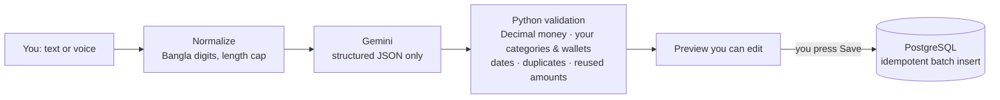
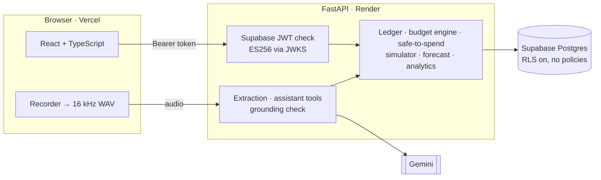

# TakaWise AI

**An AI expense tracker and budget planner for Bangladesh — in English, বাংলা and Banglish, by text or voice.**

Type or say *"Ajke 100 taka rickshaw vara, 200 taka lunch, ar 50 taka cha kheyechi"* and you get three
transactions to review before anything is saved. Ask *"Ei mash e koto khoroch holo?"* or *"Can I buy a
2,500 taka keyboard and still save this month?"* and the answer comes from your own records.

> **Live demo:** _link added after deployment_ · demo login in the [Demo account](#demo-account) section

---

## Why it's different

Expense trackers and chatbots exist. TakaWise combines a few ideas that are rarely together:

| | |
|---|---|
| **Bangla / Banglish / English, text and voice** | Number words ("dedh hajar" = ৳1,500), "kal" resolved as yesterday or tomorrow from the verb tense, Bangla digits, code-switched speech. |
| **Commitment-aware "safe to spend"** | What you can spend *after* reserving unpaid bills, this month's savings and essential budgets — with a per-day and per-week figure. |
| **What-if purchase simulator** | Affordable / over budget / cuts into savings / not affordable — with alternatives. Records nothing. |
| **Irregular income** | Expected income (tuition, freelance) is tracked separately and never counted until it arrives. |
| **Adaptive budgets with consent** | When a category is heading over, the app proposes moving money from categories with room. Nothing changes until you approve; every change is kept in a history. |

## The core rule: AI proposes, Python decides, you confirm



- **The LLM never writes data.** Extraction returns a *draft*; saving goes through the normal API, which
  validates everything again.
- **The LLM never does money maths.** Budgets, safe-to-spend, forecasts and simulations are deterministic,
  unit-tested Python. The model only reads your words and phrases results.
- **The assistant has read-only tools** (balances, spending, budgets, forecast, simulator…) scoped to the
  signed-in user. There is no tool that can create, edit or delete anything — a test runs every tool and
  checks nothing changed.
- **Grounding check:** every ৳ amount in an assistant answer must match the tool results (or a sum/difference
  of two). Otherwise the model is asked to correct it once, then the answer is flagged. *(Added after live
  testing caught the model writing ৳11,900.50 for ৳11,990.50.)*
- **Silence guard for voice:** given an all-silent recording, a real model hallucinated
  *"bKash-e 500 taka pathalam"*. Silent audio is now rejected in plain Python before any AI call.

## Architecture



**Money correctness**
- `NUMERIC(14,2)` in Postgres, `Decimal` in Python, strings over JSON; the frontend never adds floats
  (BigInt-based sums, lakh-grouped formatting: ৳1,25,000).
- **Balances are derived, never stored** — opening balance + history — so edits and deletes can't drift them.
- **Idempotency keys** on every money action: double clicks and retries can't save twice.
- Database CHECK constraints back up the rules (transfers need two different wallets, expenses need a category…).

**Security & privacy**
- Every query is filtered by the verified user id; Postgres RLS is enabled with no policies so Supabase's
  public data API exposes nothing.
- Security headers + a strict Content-Security-Policy (inline script allowed only by hash — tested).
- Voice recordings are processed in memory and never stored. AI prompts aren't saved unless you opt in.
- Export your transactions as CSV (formula-injection safe); delete all data or your whole account.

## Features

- Wallets (Cash, bKash, Nagad, Rocket, bank, savings), transfers, balance corrections
- Transactions: add/edit/delete, filters, month view
- AI quick entry (text + voice), multi-item messages, future plans listed but not recorded
- Budgets: describe your month in plain language → calculated plan that always adds up exactly
- Monthly bills (mark paid), expected income, safe-to-spend, purchase simulator
- Insights: category breakdown, daily spending, this vs last month (same days), budget vs actual,
  income vs expenses, month-end forecast — every chart has a table view
- Assistant with follow-up questions and "data used" cards
- Budget warnings and approve/dismiss budget adjustments with history
- Dark mode, phone layout, reduced-motion support

## Quality — tested, and measured honestly

| | |
|---|---|
| Backend tests | **226** (pytest; DB tests run against PostgreSQL 17 in CI) |
| Frontend tests | **55** (Vitest: money maths, dates, WAV encoding, safe markdown, CSP) |
| AI extraction eval | **33/33** first run; **30/33** on a rerun (2 provider outages, 1 reused-amount error → now flagged) |
| Assistant eval | **11/11** with fixed tool data (right tool, exact numbers, language mirrored) |
| AI budget extraction | **4/4** (English, Banglish, Bangla script, missing-income clarification) |

Evals live in `backend/tests/ai_eval/` and run against the real model:
`python -m tests.ai_eval.run_eval` and `python -m tests.ai_eval.assistant_eval`.

## Tech stack

| Layer | Tech |
|---|---|
| Frontend | React 19, TypeScript, Vite, Tailwind CSS v4, shadcn/ui, TanStack Query, React Router, Recharts |
| Backend | Python 3.13, FastAPI, Pydantic v2, SQLAlchemy 2, Alembic, psycopg 3 |
| Database & auth | Supabase (PostgreSQL 17 + Auth) |
| AI | Gemini Flash-Lite (structured output, function calling, audio transcription); optional Groq Whisper fallback |
| Hosting | Vercel (frontend), Render (backend), Supabase (DB) |

## Local development

**Requirements:** Node 20+, Python 3.12+, a Supabase project and a Gemini API key.

```bash
# Backend
cd backend
python -m venv .venv
.venv\Scripts\Activate.ps1          # macOS/Linux: source .venv/bin/activate
pip install -e ".[dev]"
cp .env.example .env                # fill in values (see below)
alembic upgrade head
uvicorn app.main:app --reload       # http://localhost:8000 (API docs at /docs)

# Frontend
cd frontend
npm install
cp .env.example .env.local
npm run dev                         # http://localhost:5173
```

Checks: `pytest` and `ruff check .` (backend) · `npm test`, `npm run lint`, `npm run build` (frontend).
Database tests need `TEST_DATABASE_URL` pointing at a **separate, disposable** Postgres (they drop the schema).

## Environment variables

| Where | Variable | Purpose | Secret |
|---|---|---|---|
| backend | `DATABASE_URL` | Supabase **session pooler** connection string | **yes** |
| backend | `SUPABASE_URL` | Project URL (JWT issuer + JWKS) | no |
| backend | `SUPABASE_SERVICE_ROLE_KEY` | Admin key, only for "delete my account" (optional) | **yes** |
| backend | `GEMINI_API_KEY` | AI extraction, assistant, transcription | **yes** |
| backend | `GROQ_API_KEY` | Optional speech-to-text fallback | **yes** |
| backend | `CORS_ORIGINS` | Allowed frontend origins, comma-separated | no |
| backend | `ENVIRONMENT` | `production` hides `/docs` and enables HSTS | no |
| frontend | `VITE_API_URL` | Backend base URL | public |
| frontend | `VITE_SUPABASE_URL`, `VITE_SUPABASE_PUBLISHABLE_KEY` | Supabase Auth in the browser | public by design |

## Deployment

1. **Supabase** — run `alembic upgrade head` against it; under *Authentication → URL Configuration* set the
   Site URL to the Vercel URL.
2. **Render** — *New → Blueprint* with this repo (`render.yaml`): free web service, migrations run on start.
   Set the secret env vars in the dashboard.
3. **Vercel** — import the repo with root directory `frontend`, set the three `VITE_` variables.
   `vercel.json` adds SPA rewrites, caching and security headers.
4. Add the Vercel URL to `CORS_ORIGINS` on Render.

**Expected cost:** ৳0 on free tiers. Trade-offs: the Render free instance sleeps after ~15 min idle (first
request takes ~30–60 s), Supabase free projects pause after a week without activity, and Gemini's free tier
has rate limits and may use prompts to improve Google's models — use a paid key for real personal data.

## Demo account

1. Sign up in the app with a demo email (e.g. `demo@hisabify.app`).
2. `cd backend && python -m scripts.seed_demo demo@hisabify.app` — fills ~3 months of realistic student /
   freelancer data: allowance via bKash, tuition income, rent and Wi-Fi bills, a budget and expected income.

## Limitations & next steps

- Forecasts are transparent averages, not ML — a scikit-learn model makes sense once there are months of data.
- Monthly bills only (no weekly/yearly); one monthly savings target (named goals are modelled but not in the UI).
- Custom categories can't be created from the UI yet.
- Bangla speech recognition quality depends on the provider; transcripts are always shown for editing first.
- No bank/bKash integration and no real payments, by design.
